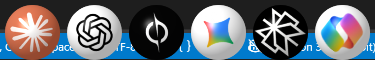

# noti-fai 🏀

**A bouncing-ball notification for when your AI finishes replying.**

You ask Claude, ChatGPT or Grok something long and switch to another window.
When the answer is ready, a ball with that AI's logo drops onto your screen. It
bounces (h, h/2, h/4, …), rolls along the bottom and waits. Click it and you're
back in that exact app or browser tab.



- **Tiny:** one native ~270 KB Windows exe with no Electron and no runtime.
  Nothing runs while there's no ball on screen.
- **Works where you chat:** Claude desktop, ChatGPT/Copilot/Perplexity desktop
  apps, and claude.ai, chatgpt.com, grok.com, gemini.google.com and
  perplexity.ai in Chrome or Edge.
- **Takes you back:** click a ball to focus the right window or tab. Right-click
  dismisses it, and it goes away by itself when you return there on your own.

> Windows 10/11 only for now.

---

## Download and set up

### 1. Download

Grab **`noti-fai-windows-x64.zip`** from the
[latest release](../../releases/latest) and extract it somewhere permanent,
for example `D:\` or `C:\Tools\`. The zip contains a `noti-fai` folder. Don't use
Downloads or Temp: the browser bridge points at this folder.

### 2. Install

Open PowerShell in the extracted `noti-fai` folder and run:

```powershell
powershell -ExecutionPolicy Bypass -File .\install.ps1
```

This sets up everything for your user only, with no admin rights needed:

- registers noti-fai with Chrome and Edge so the extension can talk to it
- starts the desktop watcher now and adds it to your sign-in startup
  (`noti-fai watch`)

### 3. Add the browser extension

1. Open `chrome://extensions` (or `edge://extensions`).
2. Turn on **Developer mode** (top right).
3. Click **Load unpacked** and select the `extension` folder inside your noti-fai
   folder.

That's it. Ask a chatbot something, switch tabs, and wait for the ball.

### Try it right away

```powershell
.\dist\noti-fai.exe notify --agent claude --always
```

### Uninstall

```powershell
powershell -ExecutionPolicy Bypass -File .\install.ps1 -Uninstall
```

Then remove the extension from `chrome://extensions` and delete the folder.

---

## What triggers a ball

| Where you chat | How noti-fai knows it's done |
|---|---|
| Claude desktop (chat and Code tab), ChatGPT, Copilot, Perplexity desktop apps | The app's own "response ready" Windows notification |
| claude.ai, chatgpt.com, grok.com, gemini.google.com, perplexity.ai | The extension sees the site's **Stop** button disappear |
| Claude Code CLI, scripts, anything else | Run `noti-fai notify` (see below) |

For desktop apps, make sure notifications are on for them in **Windows Settings →
System → Notifications**. In the browser, no ball appears if you were already
looking at that tab.

### Claude Code hook

Add to `~/.claude/settings.json`:

```json
{
  "hooks": {
    "Stop": [
      { "hooks": [ { "type": "command", "command": "\"D:/noti-fai/dist/noti-fai.exe\" notify --agent claude" } ] }
    ]
  }
}
```

`notify` returns immediately, so it never slows Claude Code down.

---

## Performance

Measured on Windows 11, with a 112 px ball at 175% display scaling:

| Part | When | CPU | RAM (private) |
|---|---|---|---|
| Ball | bouncing (~4 s) | ~2% of one core | 1.6 MB |
| Ball | resting | 0% | 1.6 MB |
| Ball | no ball on screen | not running | 0 |
| Desktop watcher | first 2 min after you leave an AI app | ~1% of one core | 3 MB |
| Desktop watcher | 2–30 min after you leave it | ~0.2% of one core | 3 MB |
| Desktop watcher | an AI app is busy on screen | ~1.25% of one core | 3 MB |
| Desktop watcher | otherwise | two tiny checks every 2 s | 3 MB |
| Browser bridge | a tab's ball is on screen | 0% | ~1 MB |
| Browser bridge | otherwise | not running | 0 |

How it stays this light:

- **No daemon for the ball.** The ball process starts when needed and exits with
  the last ball. It runs one timer only while something moves, and none at rest.
- **Precomputed rendering.** The circle mask and lighting are calculated once.
  Each frame is just "rotate the logo and multiply".
- **A gated watcher.** Windows doesn't let normal apps subscribe to new
  notifications, and reading the list costs ~20 ms. So the watcher only reads
  it when a reply could be landing: after you switch away from an AI app
  (every 2 s for 2 minutes, then every 10 s for up to 30 minutes, stopping as
  soon as you return), or while the app is busy. Otherwise it only checks which
  window is in front and how much CPU the AI apps used, a few microseconds
  each.
- **A lazy extension.** It checks the page only when the page changes, at most
  4 times a second. The connection to the desktop exists only while a ball from
  that tab is on screen.

---

## Command line

```
noti-fai notify [--agent NAME] [--icon IMAGE] [--hwnd WINDOW] [--always]
noti-fai watch
noti-fai quit
```

| Option | Meaning |
|---|---|
| `--agent` | `claude`, `chatgpt`, `grok`, `gemini`, `perplexity`, `copilot`, or any name. It picks the logo `icons\NAME.png`. |
| `--icon` | Use this image instead (png, ico, jpg or bmp) |
| `--hwnd` | Window to focus on click (default: the window that ran the command) |
| `--always` | Show the ball even if that window is already in front |

`quit` removes all balls.

### Logos

The ball's face is chosen in this order:

1. `dist\icons\<agent>.png` (also `.ico`, `.jpg` or `.bmp`). Drop in your own
   file to add an agent or restyle one.
2. `--icon <image>`.
3. The logo of an installed Microsoft Store app whose name matches the agent.
4. A plain colour-coded ball.

---

## Build from source

You need [Rust](https://rustup.rs) with the MSVC toolchain (Visual Studio Build
Tools, "Desktop development with C++").

```powershell
git clone https://github.com/itsofficially-sreyash/noti-fai
cd noti-fai
cargo build --release
copy target\release\noti-fai.exe dist\
```

To produce the release zip:

```powershell
powershell -ExecutionPolicy Bypass -File .\package.ps1
```

### Project layout

```
src/main.rs        ball host: physics, rendering, click handling, notify
src/watch.rs       desktop watcher (Windows notifications)
src/native.rs      browser bridge (Chrome/Edge native messaging)
extension/         Chrome/Edge extension (Manifest V3)
dist/icons/        bundled logos
install.ps1        per-user install and uninstall
package.ps1        builds noti-fai-windows-x64.zip
```

---

## Troubleshooting

- **No ball from the browser:** check that `install.ps1` ran from the folder
  you're using now. Run it again after moving the folder. Then reload the
  extension.
- **No ball from Claude desktop:** turn on Windows notifications for Claude, and
  check that `noti-fai.exe` is running (Task Manager → Details).
- **A site changed and stopped working:** the site probably renamed its Stop
  button. Update the selector in `extension/content.js`; pull requests are
  welcome.

## Contributing

Issues and PRs are welcome. Support for macOS and Linux and for more chat sites
would be great additions.

## License

[MIT](LICENSE). Claude, ChatGPT, Grok, Gemini, Perplexity and Copilot names and
logos are trademarks of their respective owners. They are used here only to show
which assistant finished. noti-fai is not affiliated with or endorsed by any of
them.
